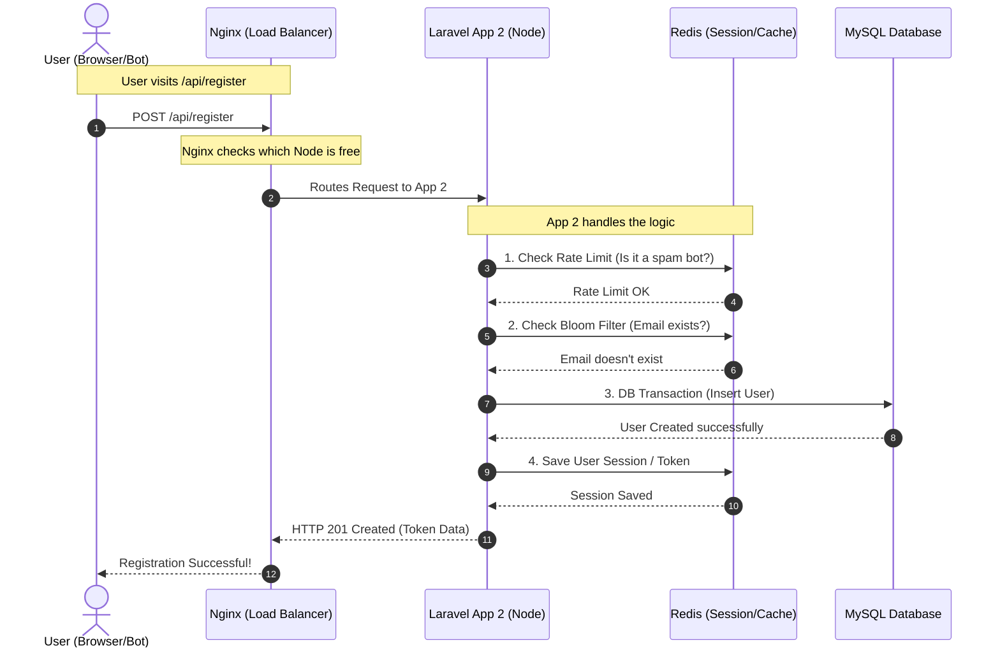

# Docker Infrastructure & Load Balancing Architecture

এই ডকুমেন্টটি আমাদের `docker-compose.yml` এবং `nginx.conf` ফাইলের রিয়েল-লাইফ ভিজ্যুয়াল রিপ্রেজেন্টেশন।

---

## ১. Static Architecture (ইনফ্রাস্ট্রাকচার ম্যাপ)

এই ডায়াগ্রামটি দেখায় আমাদের ডকার নেটওয়ার্কে কী কী সার্ভার বা কন্টেইনার আছে এবং তারা কীভাবে কানেক্টেড।

---

config:
layout: dagre
flowchart:
curve: cardinal

---

flowchart LR
classDef client fill:#f0f9ff,stroke:#38bdf8,stroke-width:2px;
classDef proxy fill:#fdf4ff,stroke:#e879f9,stroke-width:2px;
classDef laravel fill:#eef2ff,stroke:#818cf8,stroke-width:2px;
classDef data fill:#f0fdfa,stroke:#2dd4bf,stroke-width:2px;
classDef database fill:#fff7ed,stroke:#fb923c,stroke-width:2px;
classDef request fill:#fefce8,stroke:#facc15,stroke-width:2px;

    Client((User / Bot Army)):::client
    Request((HTTP Request)):::request

    subgraph Docker_Network["Local Docker Compose Network"]
        Nginx{"Nginx Load Balancer Port: 7000"}:::proxy

        subgraph Laravel_Cluster["Laravel Application Nodes"]
            App1["Laravel App 1 Port: 8001"]:::laravel
            App2["Laravel App 2 Port: 8002"]:::laravel
            App3["Laravel App 3 Port: 8003"]:::laravel
        end

        subgraph Data_Layer["Data & Cache Layer"]
            Redis[("Redis Port: 6379")]:::data
            MySQL[("MySQL 8.0 Port: 3306")]:::database
        end
    end

    Client -.->|Sends request| Request
    Request r1@==>|Arrives at load balancer| Nginx
    Nginx r2@==>|Round Robin 1| App1
    Nginx r3@==>|Round Robin 2| App2
    Nginx r4@==>|Round Robin 3| App3

    App1 --> Redis
    App1 --> MySQL
    App2 --> Redis
    App2 --> MySQL
    App3 --> Redis
    App3 --> MySQL

    App1 -.->|Response| Client
    App2 -.->|Response| Client
    App3 -.->|Response| Client

    r1@{ animate: true, animation: fast }
    r2@{ animate: true, animation: fast }
    r3@{ animate: true, animation: fast }
    r4@{ animate: true, animation: fast }

## ২. Dynamic Request Flow (ডাইনামিক সিকোয়েন্স)

**User যখন রিকোয়েস্ট পাঠায়, তখন ঠিক কীভাবে ভেতরে কাজ হয়?**
নিচের এই সিকোয়েন্স (Sequence) ডায়াগ্রামটি কপি করে [Mermaid Live Editor](https://mermaid.live/)-এ দেখলে আপনি বুঝতে পারবেন মিলি-সেকেন্ডের মধ্যে ডেটা কীভাবে ট্রাভেল করে!

---

### এই ইনফ্রাস্ট্রাকচার থেকে কী শিখবেন?

১. **Nginx এর কাজ:** Nginx এখানে റിভার্স প্রক্সি (Reverse Proxy) হিসেবে কাজ করছে। ইউজার জানে না ভেতরে ৩টি সার্ভার আছে, ইউজার শুধু `7000` পোর্টে রিকোয়েস্ট পাঠায়। Nginx নিজে থেকে ঠিক করে কোন অ্যাপটি ফ্রি আছে (Round-Robin)।
২. **Isolation (আইসোলেশন):** ডকারের কারণে MySQL বা Redis আপনার মেইন উইন্ডোজ পিসিতে চলছে না। এগুলো ডকারের নিজস্ব নেটওয়ার্কের (Docker_Network) ভেতর চলছে, তাই কোনো কনফ্লিক্ট হবে না।
৩. **Centralized Session (Redis):** ডাইনামিক ডায়াগ্রামে খেয়াল করুন, App2 ইউজারের সেশন নিজের কাছে সেভ না করে Redis-এ সেভ করছে। এর ফলে ইউজার পরের বার যখন রিকোয়েস্ট করবে, তখন যদি Nginx তাকে App1-এ পাঠিয়ে দেয়, তাহলেও App1 Redis থেকে ইউজারের সেশন পেয়ে যাবে এবং ইউজার লগআউট হবে না! একে বলা হয় Stateless Architecture।
