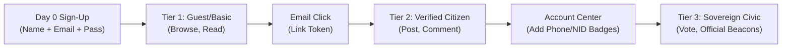

# মডিউল ০১: রেজিস্ট্রেশন ফান্ডামেন্টালস ও কোর থিওরি (Fundamentals & Core Theory)

> [📖 মূল সূচিপত্র (README)](./README.md) | [পরবর্তী মডিউল ➡️](02-System-Design-And-Architecture.md)


> **লক্ষ্য:** আইডেন্টিটি, প্রমাণীকরণ ও অনুমোদনের তাত্ত্বিক পার্থক্য স্পষ্ট করা এবং কেন শুরুতে কেবল ৩টি ফিল্ড রাখা উচিত তা মনস্তাত্ত্বিক ও প্রযুক্তিগতভাবে বোঝা।

---

## ১. আইডেন্টিটি, প্রমাণীকরণ ও অনুমোদন (The Holy Trinity of Auth)

সফটওয়্যার ইঞ্জিনিয়ারিংয়ে প্রায়ই তিনটি ধারণাকে গুলিয়ে ফেলা হয়:

```
[ ইউজার আইডেন্টিটি (Identity) ]  ---> "আপনি কে?" (নাম, ইমেইল, হ্যান্ডেল)
              │
              ▼
[ প্রমাণীকরণ (Authentication) ]  ---> "আপনি কি আসলেই সেই ব্যক্তি?" (পাসওয়ার্ড, ওটিপি, পাসকি)
              │
              ▼
[ অনুমোদন (Authorization) ]     ---> "আপনার কি এই সিস্টেমে প্রবেশের অধিকার আছে?" (রোল, পারমিশন)
```

1. **আইডেন্টিটি (Identity):** সিস্টেমে ইউজারের একক অস্তিত্ব। এটি একটি অনন্য আইডেন্টিফায়ার (যেমন: `sazzad@zengfy.com` বা UUID)।
2. **অথেনটিকেশন বা প্রমাণীকরণ (Authentication - AuthN):** প্রেরিত আইডেন্টিটি সত্য কি না তা যাচাই করার প্রক্রিয়া (যেমন: সঠিক পাসওয়ার্ড প্রদান করা)।
3. **অথরাইজেশন বা অনুমোদন (Authorization - AuthZ):** যাচাইকৃত আইডেন্টিটিকে কোন কোন কাজ করার অনুমতি দেওয়া হয়েছে তা নির্ধারণ করা (যেমন: ইউজার কি সাধারণ নাগরিক, নাকি অ্যাডমিন?)।

---

## ২. ডে ০ ফিলোসফি: ৩টি ফিল্ড কেন? (The Day 0 Three-Field Philosophy)

বাস্তব প্রজেক্টগুলোতে অনেক সময় শুরুতেই ইউজারের কাছ থেকে অজস্র তথ্য চেয়ে বসা হয়—ফোন নাম্বার, ঠিকানা, বয়স, লিঙ্গ, এনআইডি নাম্বার ইত্যাদি। এটি প্রোডাক্ট ডেভেলপমেন্টের অন্যতম বড় ভুল।

### ২.১ কনভার্সন ড্রপ-অফ ম্যাথ (Conversion Drop-off Law)
ই-কমার্স ও সাস (SaaS) ইন্ডাস্ট্রির বহুল পরিচিত গবেষণা অনুযায়ী:
- রেজিস্ট্রেশন ফর্মে প্রতি ১টি অতিরিক্ত ইনপুট ফিল্ড যুক্ত করার ফলে **১০% থেকে ১৫% ভিজিটর ফর্ম পূরণ না করেই পেজ বন্ধ করে চলে যায়**।
- ফোন নাম্বারে বাধ্যতামূলক SMS OTP যুক্ত করলে নেটওয়ার্ক ডিলে এবং ইউজারের দ্বিধার কারণে সাইন-আপ ড্রপ-অফ আরও **২৫% থেকে ৩৫% বৃদ্ধি পায়**।

```
ফর্ম ফিল্ডের সংখ্যা       ইউজার কমপ্লিশন রেট (Conversion Rate)
--------------------      -------------------------------------
৩টি ফিল্ড (Name/Email/Pass)   ████████████████████ 85% - 92%
৬টি ফিল্ড (+Phone, DOB, Gen)  ███████████ 45% - 52%
১০+ ফিল্ড (+NID, Address)     █████ 15% - 22%  (মারাত্মক বিপর্যয়!)
```

### ২.২ ডে ০ রেজিস্ট্রেশনের গোল্ডেন ফিল্ড ত্রয়ী
Zengfy প্ল্যাটফর্মে প্রথম দিনে আমরা শুধু তিনটি মৌলিক ফিল্ড নিচ্ছি:
1. **Full Name (সম্পূর্ণ নাম):** ইউজারের মানবীয় পরিচিতি ও কমিউনিকেশন অ্যাড্রেসের জন্য।
2. **Email Address (ইমেইল ঠিকানা):** গ্লোবাল ইউনিক আইডেন্টিফায়ার, পাসওয়ার্ড রিকভারি চ্যানেল এবং ফ্রিতে ভেরিফিকেশন পাঠানোর মাধ্যম।
3. **Password (পাসওয়ার্ড):** প্রাথমিক প্রমাণীকরণ মেকানিজম (কমপক্ষে ৮ অক্ষর, মিশ্র ক্যারেক্টার)।

> [!TIP]
> গুগল ওয়ান-ট্যাপ (Google 1-Tap) সাইন-ইন চালু থাকলে এই ৩টি ফিল্ডও ইউজারের টাইপ করতে হয় না; সিঙ্গেল ক্লিকে ০-ফিল্ডে একাউন্ট তৈরি হয়ে যায়।

---

## ৩. প্রগ্রেসিভ প্রোফাইলিং (Progressive Profiling & Trust Tiers)

ইউজারের সব তথ্য প্রথম দিনে না নিয়ে কখন নেওয়া হবে? সমাধান হলো **প্রগ্রেসিভ প্রোফাইলিং**।

ইউজার যখন সিস্টেমে তার অ্যাক্টিভিটি বাড়াবেন এবং উন্নত ফিচারের সুবিধা নিতে চাইবেন, তখন ধাপে ধাপে অতিরিক্ত তথ্য চাওয়া হবে:
1. **টিয়ার ১ (বেসিক মেম্বার):** ৩-ফিল্ড রেজিস্ট্রেশন সম্পন্ন। ইউজার কনটেন্ট পড়তে পারবেন, পাবলিক পোস্ট দেখতে পারবেন।
2. **টিয়ার ২ (ভেরিফাইড ইমেইল মেম্বার):** ইমেইল লিংক ক্লিক করেছেন। এখন ইউজার কমেন্ট করতে পারবেন এবং সোশ্যাল ফিডে অংশ নিতে পারবেন।
3. **টিয়ার ৩ (কমিউনিটি মেম্বার):** একাউন্ট সেন্টারে গিয়ে ফোন নাম্বার যুক্ত করেছেন। হাইপারলোকাল গ্রুপ তৈরি করতে পারবেন।
4. **টিয়ার ৪ (সার্বভৌম নাগরিক মেম্বার):** এনআইডি বা স্মার্টকার্ড ভেরিফিকেশন সম্পন্ন। অফিশিয়াল ভোট ও সিভিক ডিসিশনে অংশ নিতে পারবেন।



এই পদ্ধতির ফলে রেজিস্ট্রেশনের দিনে কোনো ইউজার আটকে থাকেন না, প্ল্যাটফর্মের গ্রোথ দ্রুত গতিতে বাড়ে, এবং ডেটাবেজে ভুয়া ইউজারের অপ্রয়োজনীয় জটলা তৈরি হয় না।

---


> [📖 মূল সূচিপত্র (README)](./README.md) | [পরবর্তী মডিউল ➡️](02-System-Design-And-Architecture.md)

