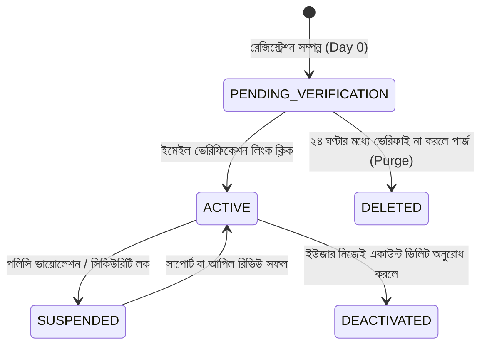

# মডিউল ০২: সিস্টেম ডিজাইন ও সফটওয়্যার আর্কিটেকচার (System Design & Architecture)

> [⬅️ পূর্ববর্তী মডিউল](01-Registration-Fundamentals-And-Theory.md) | [📖 মূল সূচিপত্র (README)](./README.md) | [পরবর্তী মডিউল ➡️](03-Security-Cryptography-And-Hardening.md)


> **লক্ষ্য:** রেজিস্ট্রেশন সাবসিস্টেমের হাই-লেভেল এবং লো-লেভেল আর্কিটেকচার ডিজাইন করা, স্টেট মেশিন মডেলিং এবং রিলেশনাল ডেটাবেজের অপ্টিমাইজড স্কিমা প্রস্তুত করা।

---

## ১. হাই-লেভেল সিস্টেম আর্কিটেকচার (High-Level Architecture)

একটি এন্টারপ্রাইজ গ্রেড রেজিস্ট্রেশন সিস্টেমের ব্লক আর্কিটেকচার:

```
[ ইউজার ডিভাইস (মোবাইল / ব্রাউজার) ]
              │ HTTPS (TLS 1.3)
              ▼
    [ Cloudflare / WAF ]  ─── (DDoS প্রটেকশন, বোট ম্যানেজমেন্ট ও আইপি জিও-ব্লকিং)
              │
              ▼
   [ Nginx Reverse Proxy / Load Balancer ]
              │
              ▼
   [ Zengfy Core Auth API Service ]
       │            │             │
       ▼            ▼             ▼
 [ Redis Cache ]  [ PostgreSQL ]  [ Async Queue (BullMQ/RabbitMQ) ]
  (রেট লিমিট ও     (মাস্টার DB,      │
   আইডেমপোটেন্সি)   ট্রানজেকশন)      ▼
                           [ Email Worker Service ]
                                   │ SMTP (TLS)
                                   ▼
                            [ Mail Provider / Postfix ]
                                   │
                                   ▼
                           [ ইউজার ইনবক্স ]
```

### কেন অ্যাসিঙ্ক্রোনাস ইমেইল কিউ (Async Email Queue) অপরিহার্য?
রেজিস্ট্রেশন রিকোয়েস্ট আসার পর ব্যাকএন্ডে কখনোই সরাসরি সিঙ্ক্রোনাসলি (Synchronously) SMTP সার্ভারের সাথে সংযোগ তৈরি করে ইমেইল পাঠানো উচিত নয়। কারণ:
- SMTP হ্যান্ডশেক এবং ইমেইল ডেলিভারিতে ১ থেকে ৩ সেকেন্ড সময় লাগতে পারে।
- কোনো কারণে SMTP প্রোভাইডার ডাউন থাকলে বা রেসপন্স করতে দেরি হলে পুরো রেজিস্ট্রেশন API টাইম-আউট হয়ে যাবে।
- সঠিক আর্কিটেকচার হলো: ডেটাবেজে ইউজার ডাটা এবং ভেরিফিকেশন টোকেন লিখে তাৎক্ষণিকভাবে কিউ-তে একটি ইভেন্ট পুশ করা (`UserRegisteredEvent`) এবং ইউজারকে সাথে সাথে `201 Created` রেসপন্স দেওয়া। ব্যাকগ্রাউন্ডে ওয়ার্কার প্রসেস সেই কিউ থেকে ইমেইল পাঠাবে।

---

## ২. ডেটাবেজ স্কিমা ডিজাইন (PostgreSQL Relational Schema)

আমরা ইন্ডাস্ট্রি-স্ট্যান্ডার্ড PostgreSQL 16 এর সুবিধাগুলো ব্যবহার করে অপ্টিমাইজড স্কিমা ডিজাইন করেছি:

```sql
-- ১. UUID এক্সটেনশন ও CITEXT (কেস-ইনসেনসিটিভ টেক্সট) এক্সটেনশন চালু করা
CREATE EXTENSION IF NOT EXISTS "uuid-ossp";
CREATE EXTENSION IF NOT EXISTS "citext";

-- ২. ইউজার স্ট্যাটাস এনুমারেটর (State Machine Enum)
CREATE TYPE user_account_status AS ENUM (
    'PENDING_VERIFICATION',
    'ACTIVE',
    'SUSPENDED',
    'DEACTIVATED'
);

-- ৩. কোর ইউজার টেবিল (Users Table)
CREATE TABLE users (
    id UUID PRIMARY KEY DEFAULT uuid_generate_v4(),
    full_name VARCHAR(100) NOT NULL,
    email CITEXT UNIQUE NOT NULL, -- স্বয়ংক্রিয় কেস-ইনসেনসিটিভ (যেমন: User@Domain.com == user@domain.com)
    password_hash VARCHAR(255) NOT NULL,
    status user_account_status NOT NULL DEFAULT 'PENDING_VERIFICATION',
    email_verified_at TIMESTAMPTZ NULL,
    created_at TIMESTAMPTZ NOT NULL DEFAULT CURRENT_TIMESTAMP,
    updated_at TIMESTAMPTZ NOT NULL DEFAULT CURRENT_TIMESTAMP,
    deleted_at TIMESTAMPTZ NULL -- সফট ডিলিট সাপোর্ট
);

-- ইনডেক্সিং অপ্টিমাইজেশন
CREATE INDEX idx_users_email ON users(email);
CREATE INDEX idx_users_status ON users(status);
CREATE INDEX idx_users_created_at ON users(created_at);

-- ৪. ইমেইল ভেরিফিকেশন টোকেন টেবিল (Tokens Table)
CREATE TABLE email_verification_tokens (
    id BIGSERIAL PRIMARY KEY,
    user_id UUID NOT NULL REFERENCES users(id) ON DELETE CASCADE,
    token_hash VARCHAR(64) NOT NULL, -- প্লেইনটেক্সট টোকেন কখনোই DB-তে থাকে না, কেবল SHA-256 হ্যাশ সংরক্ষিত হয়
    expires_at TIMESTAMPTZ NOT NULL,
    consumed_at TIMESTAMPTZ NULL, -- একবার ব্যবহার হলে টাইমস্ট্যাম্প বসবে
    created_at TIMESTAMPTZ NOT NULL DEFAULT CURRENT_TIMESTAMP
);

CREATE INDEX idx_tokens_lookup ON email_verification_tokens(token_hash, consumed_at, expires_at);

-- ৫. অডিট লগ টেবিল (Security & Compliance)
CREATE TABLE user_registration_logs (
    id BIGSERIAL PRIMARY KEY,
    user_id UUID REFERENCES users(id) ON DELETE SET NULL,
    ip_address INET NOT NULL,
    user_agent TEXT NOT NULL,
    registration_source VARCHAR(50) DEFAULT 'WEB_DIRECT',
    created_at TIMESTAMPTZ NOT NULL DEFAULT CURRENT_TIMESTAMP
);
```

---

## ৩. স্টেট মেশিন ও লাইফসাইকেল (State Machine Model)

ইউজারের একাউন্ট বিভিন্ন দশার মধ্য দিয়ে যায়। এটিকে স্টেট মেশিন হিসেবে হ্যান্ডেল করলে অনাকাঙ্ক্ষিত বাগ ও সিকিউরিটি হোল প্রতিরোধ করা যায়:



### স্টেট ট্রানজিশন রুলস:
1. `PENDING_VERIFICATION`: ইউজার লগইন করতে পারবেন, কিন্তু স্পর্শকাতর কর্মকাণ্ড (পোস্ট করা, টাকা লেনদেন, নোটিফিকেশন সাবস্ক্রিপশন) ব্লক থাকবে।
2. `ACTIVE`: সম্পূর্ণ অনুমোদিত সাধারণ মেম্বার।
3. `SUSPENDED`: কোনো স্প্যাম আক্রমণ বা ব্রুট-ফোর্স প্রচেষ্টার কারণে স্বয়ংক্রিয়ভাবে লক করা হয়েছে।

---


> [⬅️ পূর্ববর্তী মডিউল](01-Registration-Fundamentals-And-Theory.md) | [📖 মূল সূচিপত্র (README)](./README.md) | [পরবর্তী মডিউল ➡️](03-Security-Cryptography-And-Hardening.md)

