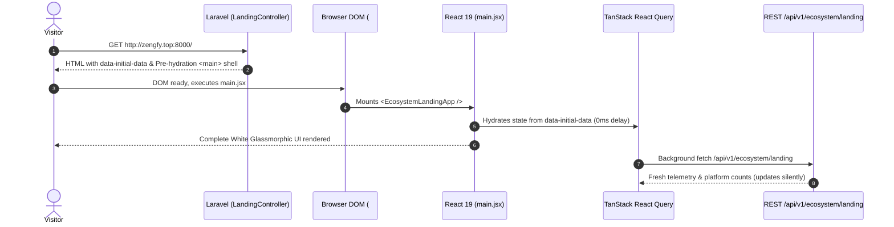

# 2. Technical Requirements Document (TRD)
## Zengfy Sovereign Ecosystem Master Web Architecture

---

### 1. Technology Stack Architecture
- **Backend Framework:** Laravel 11 (PHP 8.3)
- **Primary Domain & URL:** `http://zengfy.top:8000/`
- **Frontend Framework:** React 19 (`react` & `react-dom` `^19.3.0`) bundled via **Vite 6** (`vite` `^6.2.4`)
- **Vite Integration Plugin:** `laravel-vite-plugin` with `@vitejs/plugin-react` (`^4.7.0`) and `@tailwindcss/vite` (`^4.1.11`)
- **Styling Engine:** Tailwind CSS v4 with custom White Glassmorphism utilities (`app.css`)
- **State Management & Data Fetching:** TanStack React Query (`^5.104.1`) with dual-mode SSR hydration and background refresh
- **Icon Library:** Lucide React (`^1.52.0`)

---

### 2. Clean Single-Module Route Orchestration

To maintain complete architectural cleanliness while developing the landing phase, all extraneous module routes are detached from the root files:

```
[core/routes/web.php]
  ├── Locale Switcher (/lang/{locale})
  └── require Modules/Landing/routes/web.php
        ├── GET /          -> LandingController@index (name: welcome)
        ├── GET /download  -> Redirects to GitHub Releases
        ├── GET /login     -> Redirects to welcome (SSO ready)
        └── GET /register  -> Redirects to welcome (SSO ready)

[core/routes/api.php]
  └── require Modules/Landing/routes/api.php
        ├── GET /api/v1/ecosystem/landing -> LandingController@data
        └── GET /api/v1/ecosystem         -> LandingController@data
```

---

### 3. Vite Build & Fast Refresh Configuration

#### `vite.config.js`:
```javascript
import { defineConfig } from 'vite';
import laravel from 'laravel-vite-plugin';
import tailwindcss from '@tailwindcss/vite';
import react from '@vitejs/plugin-react';

export default defineConfig({
    plugins: [
        laravel({
            input: [
                'resources/css/app.css',
                'resources/js/app.js',
                'resources/js/react/main.jsx',
                'Modules/Landing/resources/js/main.jsx',
            ],
            refresh: true,
        }),
        tailwindcss(),
        react(),
    ],
});
```

#### Blade Mount Shell (`Modules/Landing/resources/views/index.blade.php`):
Injected with `@viteReactRefresh` to avoid the `@vitejs/plugin-react can't detect preamble` error during `npm run dev`:
```blade
<!-- React Fast Refresh Preamble + Bundled Assets -->
@viteReactRefresh
@vite(['resources/css/app.css', 'Modules/Landing/resources/js/main.jsx'])
```

---

### 4. Zero-Flicker Hydration & State Flow



---

### 5. Multi-Client API Contract (Web & Flutter Mobile)
The endpoint `GET /api/v1/ecosystem/landing` serves identical JSON metadata for both platforms:
- **React Web:** Consumes payload in `ecosystemApi.js` for desktop and mobile web rendering.
- **Flutter Mobile App:** Consumes payload at `http://10.0.2.2:8000/api/v1/ecosystem/landing` (Android Emulator) or `http://zengfy.top:8000/api/v1/ecosystem/landing` to construct native Flutter widgets.
- **Zero Pricing:** Clutter-free module metadata containing strictly `id`, `name`, `category`, `tagline`, `desc`, `icon`, `url`, `badge`.

---

### 6. Zengfy Social Module Technical Architecture (`social.zengfy.top:8000`)

#### 6.1 Route Topology & Single-Module Isolation
All bloated/crashing internal routes inside `Modules/Social/routes/web.php` and `api.php` were sanitized. Only the pure landing and public data routes are registered:

```
[Modules/Social/routes/web.php]
  ├── Subdomain Root: social.{baseDomain}
  │     ├── GET /          -> SocialLandingController@index (name: social.landing)
  │     ├── GET /download  -> Redirects to GitHub Releases
  │     ├── GET /login     -> Redirects to central SSO login
  │     └── GET /register  -> Redirects to central SSO register
  └── Base Domain Redirect:
        └── GET /social    -> Redirects to http://social.{baseDomain}:8000/

[Modules/Social/routes/api.php]
  ├── GET /v1/social/landing -> SocialLandingController@data (Public REST JSON)
  └── GET /v1/social         -> SocialLandingController@data (Shorthand alias)
```

#### 6.2 Dual-Mode Controller (`SocialLandingController.php`)
- **`index(Request $request)`:** Checks `wantsJson()`. For standard browsers, returns `social::landing` view with `$initialData` (pre-hydrating streams, stats, telemetry, SSO links).
- **`data()`:** Returns pure JSON response with status 200 OK and CORS headers for both React 19 web and Flutter mobile apps.

#### 6.3 Blade Mount Shell (`Modules/Social/resources/views/landing.blade.php`)
Lightweight 30-line HTML5 mount shell:
```blade
@viteReactRefresh
@vite(['resources/css/app.css', 'Modules/Social/resources/js/main.jsx'])
...
<div id="react-social-landing-root" data-initial-data="{{ json_encode($initialData) }}">
    <main id="main-content" role="main" class="...">
        ...
    </main>
</div>
```

#### 6.4 React 19 Frontend Components
- `Modules/Social/resources/js/main.jsx`: Mounts `SocialLandingApp` with React Query.
- `Modules/Social/resources/js/SocialLandingApp.jsx`: Orchestrates sections, ambient orbs, and skip links.
- `Modules/Social/resources/js/components/SocialNavbar.jsx`: Brand logo + 9-dot Waffle menu + SSO links.
- `Modules/Social/resources/js/components/SocialHeroSection.jsx`: Headline, Bengali subtext, CTAs, trust badges.
- `Modules/Social/resources/js/components/InteractiveFeedSimulator.jsx`: 4 channel switcher, live composer, emoji reactions.
- `Modules/Social/resources/js/components/EmergencySosRadarSection.jsx`: Live radar beacon, speed telemetry.
- `Modules/Social/resources/js/components/SocialPillarsSection.jsx`: 4 civic architecture pillars.
- `Modules/Social/resources/js/components/SocialFooter.jsx`: WCAG semantic footer with links.

#### 6.5 Production Build Status
- **Vite 6 + React 19 + Tailwind CSS v4:** Compiled successfully (`✓ built in 10.50s`, 2,044 modules, zero errors).

---

### 7. Zengfy School Module Technical Architecture (`school.zengfy.top:8000`)

#### 7.1 Route Topology & Single-Module Isolation
All legacy/crashing routes inside `Modules/School/routes/web.php` and `api.php` were cleanly sanitized, mirroring the clean slate architecture:

```
[Modules/School/routes/web.php]
  ├── Subdomain Root: school.{baseDomain}
  │     ├── GET /          -> SchoolLandingController@index (name: school.landing)
  │     ├── GET /download  -> Redirects to central download portal
  │     ├── GET /login     -> Redirects to central SSO login
  │     └── GET /register  -> Redirects to central SSO register
  └── Base Domain Redirect:
        └── GET /school    -> 302 Redirect to http://school.{baseDomain}:8000/

[Modules/School/routes/api.php]
  ├── GET /v1/school/landing -> SchoolLandingController@data (Public REST JSON)
  └── GET /v1/school         -> SchoolLandingController@data (Shorthand alias)
```

#### 7.2 Dual-Mode Controller (`SchoolLandingController.php`)
- **`index(Request $request)`:** Serves `school::landing` view passing pre-hydrated `$initialData` containing brand telemetry, RFID demo profile, 4 role journeys, grading demo subjects, and the 3 Bangladesh institutional packages.
- **`data(Request $request)`:** Returns pure JSON response with status 200 OK consumed by React 19 web and Flutter mobile applications.

#### 7.3 Blade Mount Shell (`Modules/School/resources/views/landing.blade.php`)
```blade
@viteReactRefresh
@vite(['resources/css/app.css', 'Modules/School/resources/js/main.jsx'])
...
<div id="react-school-landing-root" data-initial-data="{{ json_encode($initialData) }}">
    <main id="main-content" role="main" class="...">
        ...
    </main>
</div>
```

#### 7.4 React 19 Components (`Modules/School/resources/js/`)
- `services/schoolApi.js`: SSR dataset extractor + multi-endpoint REST fetcher with offline fallback.
- `main.jsx`: Mounts `SchoolLandingApp` with TanStack Query provider into `#react-school-landing-root`.
- `SchoolLandingApp.jsx`: Main container with ambient emerald and indigo glow orbs and skip links.
- `components/SchoolNavbar.jsx`: Frosted glass navbar with 9-dot Waffle apps launcher.
- `components/SchoolHeroSection.jsx`: Emotive Bengali copy, trust badges, and telemetry ribbon.
- `components/InteractiveRfidSimulator.jsx`: Interactive student card tap, Web Audio chime, and animated guardian SMS arrival mockup.
- `components/RoleJourneyTabs.jsx`: 4 perspective tabs (Parents, Teachers, Principals, Students) with proof cards.
- `components/DigitalReportCardSimulator.jsx`: Interactive marks sliders calculating NCTB & Madrasah GPA 5.00 in real-time.
- `components/PricingOffersSection.jsx`: 3 institutional deployment packages (Cloud SaaS ৳২,০০০/mo, One-Time Self-Hosted, Custom Enterprise).
- `components/SchoolPillarsSection.jsx`: 4 core architecture pillars (Offline RFID Mesh, Dual Curriculum, Mobile Payments, Encrypted Vault).
- `components/SchoolFooter.jsx`: Semantic footer with ecosystem navigation and API docs.

#### 7.5 Production Build Status
- **Vite 6 + React 19 + Tailwind CSS v4:** Compiled successfully (`✓ built in 28.78s`, 2,055 modules, zero errors).
