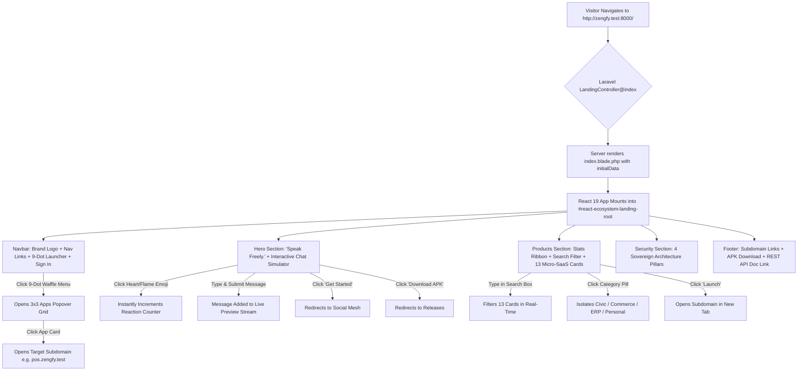
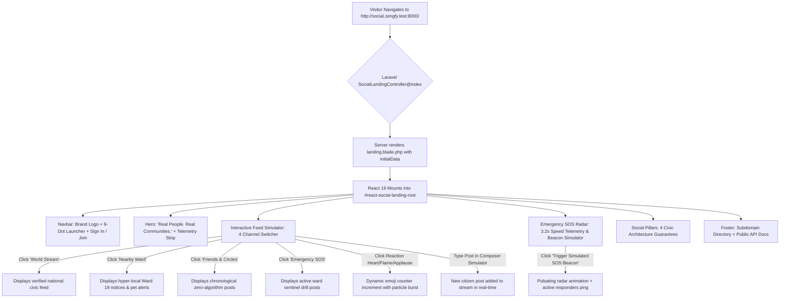
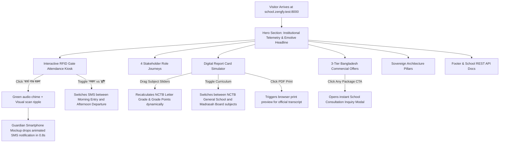

# 3. Application Flow & User Journeys (App Flow)
## Zengfy Sovereign Ecosystem Master Landing

---

### 1. High-Level Portal Navigation Flow

---

### 2. User Journey Specifications

#### Journey 1: Discovering the Sovereign Ecosystem
1. **Landing:** The user arrives at `http://zengfy.test:8000/`.
2. **First Impression:** Frosted white glass panels (`bg-white/75 backdrop-blur-2xl`) over soft pastel glow orbs create a crisp, modern aesthetic.
3. **Hero Interaction:**
   - The user reads "Speak Freely." and sees the privacy guarantee badges.
   - On the right, the interactive live chat preview shows conversation bubbles between verified citizens.
   - The user clicks the ❤️ reaction button on a message; the count increases dynamically from 28 to 29.
   - The user types a message in the preview input ("Hello from Dhaka!") and presses Enter; the message immediately appends to the conversation with an active timestamp.

#### Journey 2: Accessing Micro-SaaS Platforms via Google-Style 9-Dot Menu
1. **Trigger:** From the header, the user clicks the 9-dot Waffle menu icon.
2. **Popover Display:** A clean white popover appears containing a 3x3 grid of top platforms (Social, School, POS, Law, Rent, Hotel, Civil, Commerce, NGO).
3. **Navigation:** Clicking any icon instantly launches the subdomain (e.g. `school.zengfy.test:8000`), or clicking "View all 13 platforms" smoothly scrolls down to the full bento grid.

#### Journey 3: Filtering & Launching Platforms in the Bento Grid
1. **Live Stats:** The user observes real-time ecosystem stats (Verified Citizens, 4,554 Wards, 540+ Institutions, 99.98% Uptime).
2. **Search:** The user types "billing" or "law" in the search box; cards filter instantaneously with zero server roundtrips.
3. **Category Tabs:** The user clicks "Business & POS" to view POS, Commerce, Rent, and Hotel.
4. **Launch:** Clicking "Launch →" opens the standalone subdomain application in a new tab.

---

### 3. Accessibility & Keyboard Navigation Journey
1. **Skip to Content:** Pressing `Tab` upon initial page load reveals the high-contrast "Skip to main content / মূল তথ্যে যান" button.
2. **Direct Landmark Jump:** Pressing `Enter` bypasses the entire navigation header and shifts focus straight into `<main id="main-content" role="main">`.
3. **Screen Reader Landmarks:** Assistive software recognizes `<header role="banner">`, `<main role="main">`, `<nav role="navigation">`, and `<footer role="contentinfo">`.
4. **Escape Dismissal:** Pressing `Esc` closes the 9-dot Waffle popover menu from anywhere in the document.

---

### 4. Social Module Landing Flow & Interactive Simulator Journeys (`social.zengfy.test:8000`)

#### Journey 4: Testing the Hyperlocal Feed Simulator
1. **Channel Selection:** User clicks "📍 Nearby Ward". The view immediately switches to Ward 19 (Gulshan-2) notices regarding road maintenance and community alerts.
2. **Live Composer Test:** User types "Community clean-up drive meeting at 5 PM" in the composer input and clicks "Publish to Stream". The post instantly appears at the top of the feed with their verified badge and avatar initials.
3. **Emoji Reactions:** User clicks the 🔥 reaction on a neighbor's post; the count increments from 16 to 17 with an animated micro-burst.

#### Journey 5: Interacting with the Ward Emergency SOS Radar
1. **Radar Beacon:** User views the 3-ring pulsating sonar radar visualizer representing a 750m mesh broadcast radius.
2. **Telemetry Counters:** Real-time counters display 3.2s average response time and 34 online ward responders.
3. **Trigger Beacon Test:** User clicks "Trigger Simulated SOS Beacon", watching the active beacon simulate alerting verified neighbors within seconds.

---

### 5. Zengfy School Visitor Flow (`school.zengfy.test:8000`)

#### Journey 6: Experiencing the Interactive RFID Gate Kiosk
1. **Visitor Card Punch:** Visitor clicks the smart ID card of "সৌম্য আহমেদ" (Roll 12, Class 8th).
2. **Audio-Visual Feedback:** Scanner pulses with green ripple rings, emits a pleasant confirmation chime, and verifies the card.
3. **Guardian SMS Drop:** The adjacent smartphone screen instantly slides down a realistic government-masked SMS: *"সৌম্য সকাল ৮:০২ মিনিটে নিরাপদে মতিঝিল মডেল স্কুল ক্যাম্পাসে প্রবেশ করেছে।"*
4. **Shift Toggle:** Visitor toggles to "ছুটির প্রস্থান হাজিরা" to verify afternoon departure notification behavior.

#### Journey 7: Testing the Digital Marks & GPA Calculator
1. **Interactive Sliders:** Visitor adjusts Bangla, English, Mathematics, and Science sliders.
2. **Real-time Recalculation:** The official transcript card updates live with NCTB letter grades (A+, A, A-), total marks out of 400, and overall GPA with Golden A+ validation.
3. **Curriculum Adaptation:** Visitor toggles between General School (NCTB) and Madrasah Education Board to test Islamic studies subjects.
4. **Commercial Offer Selection:** Visitor explores the 3 deployment packages (Cloud SaaS ৳২,০০০/mo, One-Time Self-Hosted, Custom Enterprise) and clicks to submit an inquiry.

