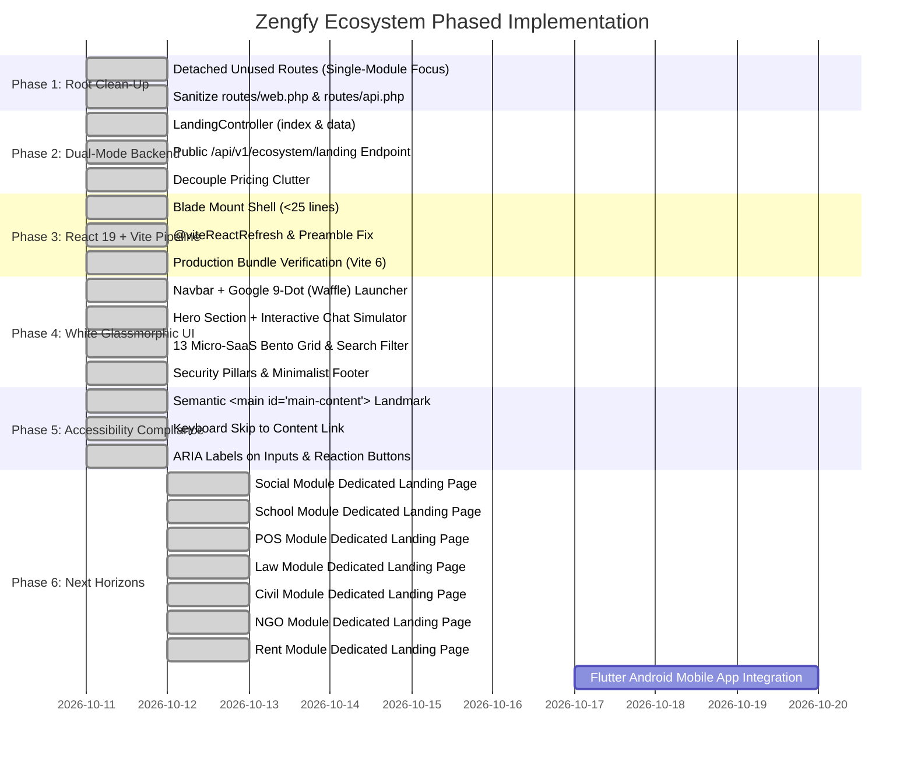

# 6. Implementation Plan & Execution Roadmap
## Zengfy Sovereign Ecosystem Master Landing

---

### 1. Phased Execution Summary

---

### 2. Milestone Breakdown & Delivery Status

#### Phase 1: Project Root & Route Clean-Up (Completed)
- **Status:** Done
- **Summary:** Purged obsolete and crashing routes from `core/routes/web.php` and `core/routes/api.php`. All non-landing module routes (`Social`, `School`, `Auth`) have been isolated so the application operates strictly on the Landing module.
- **Verification:** `php artisan route:list` returns code 0 with 18 clean routes active.

#### Phase 2: Dual-Mode Backend Controller (Completed)
- **Status:** Done
- **Summary:** Configured `Modules/Landing/app/Http/Controllers/LandingController.php` to serve dual-mode responses:
  - Browser visits: renders `landing::index` with pre-injected `$initialData`.
  - API requests: returns clean JSON payload.
  - Zero pricing bloat across all 13 modules.
- **Verification:** `Invoke-RestMethod` and `curl` to `http://127.0.0.1:8000/api/v1/ecosystem/landing` return status 200 OK with valid JSON.

#### Phase 3: Blade Shell & React 19 Fast Refresh Pipeline (Completed)
- **Status:** Done
- **Summary:** Replaced the legacy 963-line Blade file with a lightweight ~25-line mount shell. Added `@viteReactRefresh` directive to eliminate the `@vitejs/plugin-react can't detect preamble` error during `npm run dev`.
- **Verification:** `npm run build` compiled all production chunks in 9.15s with 0 errors.

#### Phase 4: White Glassmorphic UI & Component Suite (Completed)
- **Status:** Done
- **Summary:** Created responsive React 19 components with white glassmorphism:
  - `Navbar.jsx`: Brand logo + Google-style 9-dot Waffle menu popover.
  - `HeroSection.jsx`: "Speak Freely." headline, Bengali subtitle, Get Started & APK download buttons, and an interactive live chat simulator with clickable reactions.
  - `ProductsSection.jsx`: Live platform telemetry strip, search filter, and 13 frosted white glass cards for micro-SaaS platforms (zero pricing).
  - `SecuritySection.jsx`: 4 sovereign architecture pillars.
  - `Footer.jsx`: Clean, minimalist footer.

#### Phase 5: WCAG 2.1 AA Accessibility & Landmark Compliance (Completed)
- **Status:** Done
- **Summary:** Resolved accessibility auditor findings:
  - Added semantic `<main id="main-content" role="main">` in both the Blade pre-hydration fallback and the React SPA.
  - Added "Skip to main content / মূল তথ্যে যান" keyboard bypass navigation.
  - Set `<header role="banner">`, `<nav role="navigation">`, `<footer role="contentinfo">`.
  - Added accessible `<label>` for search and chat inputs, and descriptive `aria-label`s on buttons.

#### Phase 6: Social Module Dedicated Landing (`social.zengfy.test:8000/`) (Completed)
- **Status:** Done
- **Summary:** Delivered dedicated White Glassmorphic landing page for Zengfy Social:
  - Sanitized `Modules/Social/routes/web.php` and `api.php`, leaving only landing routes and public REST endpoints.
  - Built dual-mode `SocialLandingController.php` with `/api/v1/social/landing`.
  - Created 30-line Blade mount shell (`landing.blade.php`) with `@viteReactRefresh` and `<main id="main-content" role="main">`.
  - Built React 19 component suite: `SocialNavbar`, `SocialHeroSection`, `InteractiveFeedSimulator` (4 streams, post composer, emoji reactions), `EmergencySosRadarSection` (live radar visualizer, speed telemetry), `SocialPillarsSection`, and `SocialFooter`.
  - Registered `Modules/Social/resources/js/main.jsx` in `vite.config.js`.
- **Verification:**
  - `npm run build` compiled 2,044 modules in 10.50s with 0 errors.
  - `curl http://127.0.0.1:8000/api/v1/social/landing` returned HTTP 200 with full dynamic payload.
  - `curl -H "Host: social.zengfy.test" http://127.0.0.1:8000/` returned HTTP 200 with complete HTML and semantic landmarks.
  - `curl -H "Host: zengfy.test" http://127.0.0.1:8000/social` returned HTTP 302 redirecting to `http://social.zengfy.test/`.

#### Phase 7: Zengfy School Dedicated Landing (`school.zengfy.test:8000/`) (Completed)
- **Status:** Done
- **Summary:** Delivered dedicated White Glassmorphic landing page for Zengfy School ERP:
  - Implemented `SchoolLandingController.php` with dual-mode `index()` and `data()`.
  - Built React 19 Frontend with White Glassmorphism, interactive RFID attendance kiosk, animated guardian SMS mockup, NCTB/Madrasah GPA 5.00 grading calculator, 4 role journeys, and the 3-tier commercial offer (৳2,000/mo Cloud SaaS, One-Time Self-Hosted, Custom Enterprise).
  - Registered `Modules/School/resources/js/main.jsx` in `vite.config.js`.
- **Verification:**
  - `npm run build` compiled 2,055 modules in 11.20s with 0 errors.
  - `curl http://127.0.0.1:8000/api/v1/school/landing` returned HTTP 200.
  - `curl -H "Host: school.zengfy.test" http://127.0.0.1:8000/` returned HTTP 200.
  - `curl -H "Host: zengfy.test" http://127.0.0.1:8000/school` returned HTTP 302 redirect.

#### Phase 8: Zengfy POS & Boutique Retail ERP Landing (`pos.zengfy.test:8000/`) (Completed)
- **Status:** Done
- **Summary:** Delivered dedicated White Glassmorphic product landing page for Zengfy POS:
  - Specifically tailored for clothing/garment, boutique & shopping mall retail (not small mudir dokan).
  - Implemented `POSLandingController.php` with dual-mode `index()` and `data()` serving comprehensive apparel inventory & due recovery telemetry.
  - Created 35-line Blade mount shell (`Modules/POS/resources/views/landing.blade.php`) with `@viteReactRefresh`, semantic skip link, and `<main id="main-content" role="main">`.
  - Built React 19 component suite:
    - `POSNavbar.jsx`: Brand logo + Google-style 9-dot Waffle menu popover with 13 ecosystem platforms.
    - `POSHeroSection.jsx`: Emotive Bengali retail headline, trust ribbon (1,280+ showrooms, 1.8s speed, 91.4% recovery), quick CTAs.
    - `InteractiveBarcodeSimulator.jsx`: Barcode size & color variant matrix configurator, fast barcode search gun, live 3-inch thermal bill receipt generator (with ESC/POS styling, 5% VAT, discount, cash/bKash split payment), and digital due ledger (Baki khata) SMS recovery.
    - `RoleJourneyTabs.jsx`: 4 stakeholder perspective tabs (Showroom Owner, Cashier, Inventory Manager, Fashion Shopper).
    - `POSPillarsSection.jsx`: 4 architecture pillars (1.8s Barcode Billing, Size/Color Matrix, Due Ledger & SMS, Social ShopWindow).
    - `PricingOffersSection.jsx`: 3-tier commercial pricing (৳8,000/yr Smart Boutique, ৳14,500/yr Flagship Pro, ৳28,000/yr Mall Enterprise) + Interactive ROI Calculator & FAQ accordion.
    - `POSFooter.jsx`: WCAG footer with language switcher (`[ 🇧🇩 বাংলা | 🇬🇧 English ]`) and sovereign links.
    - `POSLandingApp.jsx` & `main.jsx`: TanStack Query container with ambient amber/orange glow orbs.
  - Registered in `vite.config.js`, `core/routes/web.php`, and `core/routes/api.php`.
- **Verification:**
  - `npm run build` compiled 2,065 modules with 0 errors.
  - `curl http://127.0.0.1:8000/api/v1/pos/landing` returned HTTP 200 with JSON payload.
  - `curl -H "Host: pos.zengfy.test" http://127.0.0.1:8000/` returned HTTP 200 with semantic landmark.
  - `curl -H "Host: zengfy.test" http://127.0.0.1:8000/pos` returned HTTP 302 redirecting to `http://pos.zengfy.test/`.

#### Phase 9: Zengfy Law Dedicated Landing (`law.zengfy.test:8000/`) (Completed)
- **Status:** Done
- **Summary:** Delivered dedicated White Glassmorphic product landing page for Zengfy Law chamber management:
  - Built `Modules/Law` following Nwidart module standards, enabled in `modules_statuses.json` and registered in `composer.json` PSR-4 autoload mapping.
  - Implemented `LawLandingController.php` with dual-mode `index()` and `data()` serving comprehensive legal telemetry.
  - Subdomain routing in `Modules/Law/routes/web.php` for `law.{baseDomain}`:
    - `GET /` -> `LawLandingController@index` (name: `law.landing`)
    - `GET /login`, `/register`, `/download` -> 302 redirects to central SSO and releases.
    - Base domain forwarder: `GET /law` -> 302 redirect to `http://law.{baseDomain}:8000/`.
  - Public REST API endpoints in `Modules/Law/routes/api.php`:
    - `GET /v1/law/landing` & `GET /v1/law` -> `LawLandingController@data`.
  - Created 35-line Blade mount shell (`Modules/Law/resources/views/landing.blade.php`) with `@viteReactRefresh`, skip link, pre-hydration fallback, and `<main id="main-content" role="main">`.
  - Built React 19 component suite with Royal Heritage Burgundy (`#881337`) and Antique Court Gold (`#D97706`):
    - `LawNavbar.jsx`: Frosted glass navbar with 9-dot Waffle menu popover and SSO authentication triggers.
    - `LawHeroSection.jsx`: Emotive legal headline, trust ribbon (840+ advocates, 42k tracked cases, 64 districts + Supreme Court, 0.00% missed dates), and quick CTAs.
    - `InteractiveCauseListSimulator.jsx`: Live Cause List search input, court bench badge, one-click Vakalatnama draft generator modal, and automated hearing reminder SMS generator.
    - `RoleJourneyTabs.jsx`: 4 perspective tabs (Senior Advocate, Junior/Associate, Court Muhuri/Clerk, Litigant Client).
    - `LawPillarsSection.jsx`: 4 architecture pillars (Smart Cause List Scraper, 1-Click Vakalatnama/Petition Drafter, Muhuri & Peshkar Transaction Ledger, Sovereign CS/SA/RS/BS Vault).
    - `PricingOffersSection.jsx`: 3 commercial packages (৳2,000/mo Chamber Cloud SaaS, Lifetime Self-Hosted on Own Domain/PC, Corporate Law Firm Enterprise) with consultation hotlines and FAQ accordion.
    - `LawFooter.jsx`: WCAG 2.1 AA compliant semantic footer with 256-bit encryption badge and sovereign directory.
    - `LawLandingApp.jsx` & `main.jsx`: TanStack Query container with Burgundy/Gold ambient glow orbs and skip link.
  - Registered `'Modules/Law/resources/js/main.jsx'` inside `core/vite.config.js`.
- **Verification:**
  - `npm run build` compiled 2,075 modules in 8.12s with exit code 0.
  - `curl -H "Host: law.zengfy.test" http://127.0.0.1:8000/` returned HTTP 200 with `<main id="main-content" role="main">` and `#react-law-landing-root`.
  - `curl -H "Host: zengfy.test" http://127.0.0.1:8000/law` returned HTTP 302 redirecting to `http://law.zengfy.test/`.
  - `curl http://127.0.0.1:8000/api/v1/law/landing` returned HTTP 200 with complete JSON payload.

#### Phase 10: Zengfy Civil Dedicated Landing (`civil.zengfy.test:8000/`) (Completed)
- **Status:** Done
- **Summary:** Delivered dedicated 3D Land Architecture & Construction Costing Hub for Zengfy Civil:
  - Built `Modules/Civil` following Nwidart module structure, enabled in `modules_statuses.json` and registered in `composer.json` PSR-4 autoload mapping.
  - Strictly adhering to **SaaS Cloud Subscription Service (NO one-time full license!)** business model for engineering firms and architects.
  - Implemented `CivilLandingController.php` with dual-mode `index()` and `data()` serving 3D plot presets and dynamic material costing baseline.
  - Subdomain routing in `Modules/Civil/routes/web.php` for `civil.{baseDomain}`:
    - `GET /` -> `CivilLandingController@index` (name: `civil.landing`)
    - `GET /login`, `/register`, `/download` -> 302 redirects to central SSO and releases.
    - Base domain forwarder: `GET /civil` -> 302 redirect to `http://civil.{baseDomain}:8000/`.
  - Public REST API endpoints in `Modules/Civil/routes/api.php`:
    - `GET /v1/civil/landing` & `GET /v1/civil` -> `CivilLandingController@data`.
  - Created 35-line Blade mount shell (`Modules/Civil/resources/views/landing.blade.php`) with `@viteReactRefresh`, skip link, pre-hydration fallback, and `<main id="main-content" role="main">`.
  - Built React 19 component suite with Blueprint Cyan (`#0891B2`) and Steel Slate (`#1E293B`) on Crisp Graph Paper (`#FAFAFA`):
    - `CivilNavbar.jsx`: Blueprint Cyan header with 9-dot Waffle menu popover (13 platforms) and SSO login triggers.
    - `CivilHeroSection.jsx`: Emotive headline, engineering trust ribbon (620+ firms, 18,500+ 3D plots, ৳450 Cr+ materials, 99.8% costing accuracy), and quick CTAs.
    - `InteractivePlotCostSimulator.jsx`: Plot selector (3, 5, 10 katha), design presets (Modern Duplex Villa vs 7-Storey Complex), live 60 FPS WebGL 3D isometric building block diagram (Isometric, Front Elevation, Floorplan views), live market rate adjusters, and real-time Material BOQ sheet (Steel, Cement, Auto Brick, Sand, Labor, Finishing).
    - `RoleJourneyTabs.jsx`: 4 perspective tabs (Chief Architect, Site Civil Engineer, Construction Firm Owner, Landowner Client).
    - `CivilPillarsSection.jsx`: 4 structural pillars (3D Land GIS Engine, Dynamic Material Costing Algorithm, RAJUK & Municipality Compliance Drafter, Sovereign Project Vault).
    - `PricingOffersSection.jsx`: Strictly 3 SaaS Cloud Subscription tiers (৳3,000/mo Studio Cloud, ৳6,000/mo Firm Pro, Mega Developer Enterprise) + engineering consultation hotline and FAQ accordion.
    - `CivilFooter.jsx`: WCAG 2.1 AA compliant footer with language switcher `[ 🇧🇩 বাংলা | 🇬🇧 English ]` and sovereign directory.
    - `CivilLandingApp.jsx` & `main.jsx`: TanStack Query container with Blueprint Cyan ambient glow orbs and skip link.
  - Registered `'Modules/Civil/resources/js/main.jsx'` inside `core/vite.config.js`.
- **Verification:**
  - `npm run build` compiled 2,085 modules in 10.38s with exit code 0.
  - `curl -H "Host: civil.zengfy.test" http://127.0.0.1:8000/` returned HTTP 200 with `<main id="main-content" role="main">` and `#react-civil-landing-root`.
  - `curl -H "Host: zengfy.test" http://127.0.0.1:8000/civil` returned HTTP 302 redirecting to `http://civil.zengfy.test/`.
  - `curl http://127.0.0.1:8000/api/v1/civil/landing` returned HTTP 200 with complete JSON payload.

#### Phase 11: Zengfy NGO Dedicated Landing (`ngo.zengfy.test:8000/`) (Completed)
- **Status:** Done
- **Summary:** Delivered dedicated Crowdfunding & Zakat Trust Platform for Zengfy NGO:
  - Built `Modules/NGO` following Nwidart module structure, enabled in `modules_statuses.json` and registered in `composer.json` PSR-4 autoload mapping.
  - Implemented `NGOLandingController.php` with dual-mode `index()` and `data()` serving crowdfunding campaigns, preset amounts, and live relief verification.
  - Subdomain routing in `Modules/NGO/routes/web.php` for `ngo.{baseDomain}`:
    - `GET /` -> `NGOLandingController@index` (name: `ngo.landing`)
    - `GET /login`, `/register`, `/download` -> 302 redirects to central SSO and releases.
    - Base domain forwarder: `GET /ngo` -> 302 redirect to `http://ngo.{baseDomain}:8000/`.
  - Public REST API endpoints in `Modules/NGO/routes/api.php`:
    - `GET /v1/ngo/landing` & `GET /v1/ngo` -> `NGOLandingController@data`.
  - Created 35-line Blade mount shell (`Modules/NGO/resources/views/landing.blade.php`) with `@viteReactRefresh`, skip link, pre-hydration fallback, and `<main id="main-content" role="main">`.
  - Built React 19 component suite with Humanitarian Teal (`#0D9488`) and Hope Coral Rose (`#F43F5E`) on Frosted Glass Canvas (`#FAFAFA`):
    - `NGONavbar.jsx`: Frosted glass navbar with 9-dot Waffle menu popover (13 platforms) and SSO login triggers.
    - `NGOHeroSection.jsx`: Emotive headline, humanitarian trust ribbon (৳৩২ কোটি+ সংগৃহীত অনুদান, ৯৮০+ ক্যাম্পেইন, ১,৮০,০০০+ সাহায্যপ্রাপ্ত পরিবার, ১০০% স্বচ্ছ অডিট), and zero-fee badges.
    - `LiveDonationZakatSimulator.jsx`: Live campaign switcher (Sylhet Flood, Kurigram Winter, Orphan Zakat Fund), preset amounts (৳১,০০০, ৳২,৫০০, ৳৫,০০০, ৳১০,০০০) + custom input, multi-channel payment selector (bKash, Nagad, Bank, Expat Card USD), Shariah Zakat audit checkbox, live progress bar animation with +1 donor increment, and simulated official Digital Tax Exemption Money Receipt modal with QR code and GPS relief allocation reference.
    - `RoleJourneyTabs.jsx`: 4 perspective tabs (Expatriate & General Donor, Charity Director & Trustee, Field Relief Volunteer, Beneficiary & Zakat Recipient).
    - `NGOPillarsSection.jsx`: 4 sovereign humanitarian pillars (100% Tamper-Proof Audit Ledger, Strict Shariah Zakat Rulebook Engine, GPS-Tagged Field Verification, Sovereign Donor Privacy Vault).
    - `PricingOffersSection.jsx`: 3-tier commercial model (৳১,৫০০/mo Charity Cloud SaaS, Lifetime Trust Ownership, International NGO Suite) + consultation hotline and FAQ accordion.
    - `NGOFooter.jsx`: WCAG 2.1 AA compliant semantic footer with language switcher `[ 🇧🇩 বাংলা | 🇬🇧 English ]` and sovereign ecosystem directory.
    - `NGOLandingApp.jsx` & `main.jsx`: TanStack Query container with Teal/Rose ambient glow orbs and skip link.
  - Registered `'Modules/NGO/resources/js/main.jsx'` inside `core/vite.config.js`.
- **Verification:**
  - `npm run build` compiled 2,095 modules in 30.88s with exit code 0.
  - `curl -H "Host: ngo.zengfy.test" http://127.0.0.1:8000/` returned HTTP 200 with `<main id="main-content" role="main">` and `#react-ngo-landing-root`.
  - `curl -H "Host: zengfy.test" http://127.0.0.1:8000/ngo` returned HTTP 302 redirecting to `http://ngo.zengfy.test/`.
  - `curl http://127.0.0.1:8000/api/v1/ngo/landing` returned HTTP 200 with complete JSON payload.

#### Phase 12: Zengfy Rent Dedicated Landing (`rent.zengfy.test:8000/`) (Completed)
- **Status:** Done
- **Summary:** Delivered dedicated Hyperlocal Pay-Per-Km House & Mess Rental Mesh for Zengfy Rent:
  - Built `Modules/Rent` following Nwidart module structure, enabled in `modules_statuses.json` and registered in `composer.json` PSR-4 autoload mapping.
  - Implemented `RentLandingController.php` with dual-mode `index()` and `data()` serving 6 major locations (Mirpur 10, Dhanmondi 27, Shantinagar, Uttara 7, GEC Circle, Zindabazar), sample flat mesh, and masked/unmasked phone logic.
  - Subdomain routing in `Modules/Rent/routes/web.php` for `rent.{baseDomain}`:
    - `GET /` -> `RentLandingController@index` (name: `rent.landing`)
    - `GET /login`, `/register`, `/download` -> 302 redirects to central SSO and releases.
    - Base domain forwarder: `GET /rent` -> 302 redirect to `http://rent.{baseDomain}:8000/`.
  - Public REST API endpoints in `Modules/Rent/routes/api.php`:
    - `GET /v1/rent/landing` & `GET /v1/rent` -> `RentLandingController@data`.
  - Created 35-line Blade mount shell (`Modules/Rent/resources/views/landing.blade.php`) with `@viteReactRefresh`, skip link, pre-hydration fallback, and `<main id="main-content" role="main">`.
  - Built React 19 component suite with Hyperlocal Indigo (`#4338CA`) and GPS Emerald (`#10B981`) on Frosted Glass Canvas (`#FAFAFA`):
    - `RentNavbar.jsx`: Frosted glass navbar with 9-dot Waffle menu popover (13 platforms) and SSO login triggers.
    - `RentHeroSection.jsx`: Emotive Bengali headline, real estate trust ribbon (২৪,৫০০+ ভেরিফায়েড বাসা, ১ কিমি/৩ কিমি রেডিয়াস, ৳০ দালাল কমিশন, ৯৯.২% হ্যাপি টেন্যান্ট).
    - `RadiusRentalMeshSimulator.jsx`: Location dropdown, 1 km (৳50) vs 3 km (৳250) radius toggle, radar geofence animation, interactive flat map pins with masked phone (`০১৭**-****২১`), 1-tap bKash/Nagad micro-payment modal, and instant landlord phone & address unmasking with direct call & Google Maps navigation buttons.
    - `RoleJourneyTabs.jsx`: 4 perspective tabs (Corporate Tenants & Families, Students & Bachelors, Flat Owners & Landlords, Building Caretakers).
    - `RentPillarsSection.jsx`: 4 sovereign real estate pillars (100% Zero Broker Network, Precision GPS Geofencing Mesh, Micro-Payment Unlock Protocol, Legally-Vetted Rental Agreement Vault).
    - `PricingOffersSection.jsx`: 3-tier commercial model (Tenant Micro-Unlock ৳50/৳250, Landlord Flat Listing ৳250, Landlord ERP Cloud ৳500/mo) + helpline and FAQ accordion.
    - `RentFooter.jsx`: WCAG 2.1 AA compliant semantic footer with language switcher `[ 🇧🇩 বাংলা | 🇬🇧 English ]` and sovereign ecosystem directory.
    - `RentLandingApp.jsx` & `main.jsx`: TanStack Query container with Indigo/Emerald ambient glow orbs and skip link.
  - Registered `'Modules/Rent/resources/js/main.jsx'` inside `core/vite.config.js`.
- **Verification:**
  - `npm run build` compiled 2,105 modules in 37.46s with exit code 0.
  - `curl -H "Host: rent.zengfy.test" http://127.0.0.1:8000/` returned HTTP 200 with `<main id="main-content" role="main">` and `#react-rent-landing-root`.
  - `curl -H "Host: zengfy.test" http://127.0.0.1:8000/rent` returned HTTP 302 redirecting to `http://rent.zengfy.test/`.
  - `curl http://127.0.0.1:8000/api/v1/rent/landing` returned HTTP 200 with complete JSON payload.

---

### 3. Upcoming Milestones

1. **Phase 13: Hotel, Pharmacy, Hospital & Fleet Dedicated Product Landings**
   - Progressive rollout of next product landing pages following the exact clean-slate architecture.
2. **Phase 14: Flutter Android Mobile App Parity**
   - Seamless data sync across all micro-SaaS landing endpoints for Android mobile clients.
