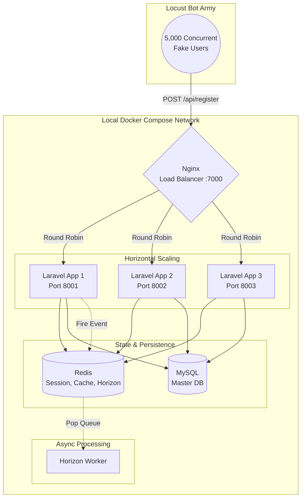
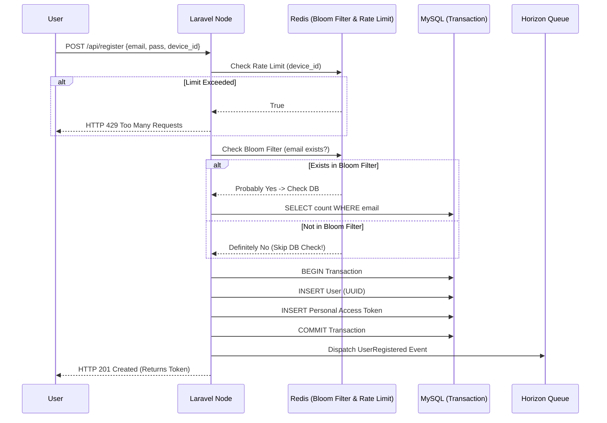
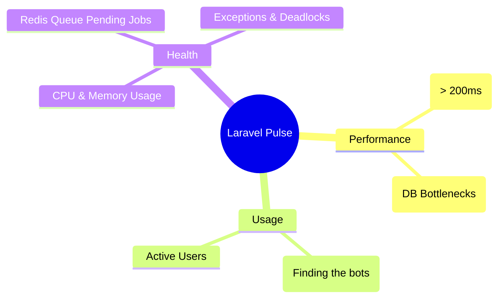

# System Design Masterclass: 10M Scale Enterprise Registration

এই ডকুমেন্টটি আপনার **Enterprise Registration System**-এর ভিজ্যুয়াল ব্লুপ্রিন্ট। এটি রিয়েল-ওয়ার্ল্ড ক্লাউড আর্কিটেকচার (Docker, Load Balancing, Redis, Queue) লোকাল মেশিনে কীভাবে কাজ করবে, তার সিস্টেম ডিজাইন।

---

## 1. The High-Level Architecture (The Big Picture)
কীভাবে হাজার হাজার বোট (Bots) আমাদের সিস্টেমে হিট করবে এবং সিস্টেম তা হ্যান্ডেল করবে:

---

## 2. The Registration Logic Flow (Senior Level)
একটি সিঙ্গেল রেজিস্ট্রেশন রিকোয়েস্ট ভেতরে কীভাবে প্রসেস হবে:

---

## 3. Real-Time Monitoring (Laravel Pulse)
হাজার হাজার রিকোয়েস্ট আসার সময় আমরা ড্যাশবোর্ডে কী কী মনিটর করবো:

