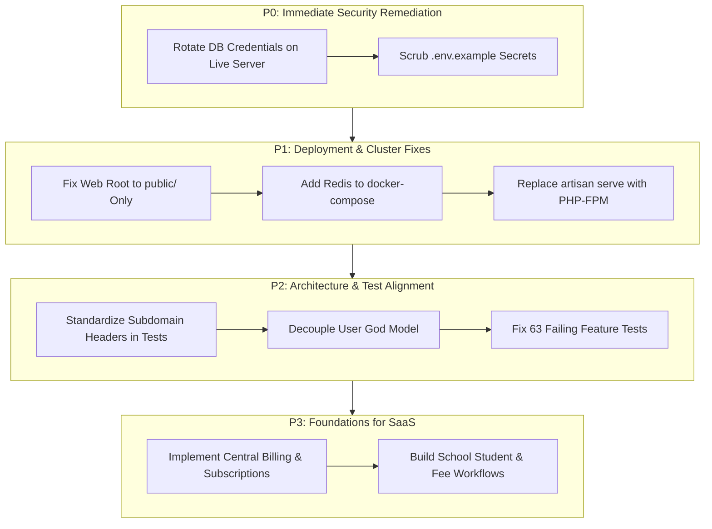

# Zengfy Phase 0 — Repository Audit & Engineering Baseline

**Audit Date:** 2026-10-27  
**Audit Author:** Antigravity AI Engineering Baseline Agent  
**Repository:** [github.com/diusazzad/zengfy](https://github.com/diusazzad/zengfy)  
**Target Branch:** `chore/phase-0-repository-audit`  
**Execution Context:** Clean workspace, zero application code modified, verified through command execution and deep static/runtime inspection.

---

## 1. Executive Summary

Zengfy is designed as a unified, multi-product SaaS ecosystem spanning social networking, institution management (School, Law, NGO), enterprise commerce, and identity management under subdomains of `zengfy.com` (and `*.zengfy.test` for local development).

The purpose of this Phase 0 audit is to establish an unvarnished, evidence-backed engineering baseline of the repository before new feature development or refactoring begins.

### Key Audit Findings:
1. **Product Implementation Gap:** Out of 18 discovered modules in `Modules/`, only **3 modules** (`Auth`, `Organization`, `Social`) are implemented and backed by working domain migrations and test coverage. **1 module** (`School`) is partially implemented with academic structure models only. **1 module** (`Accounts`) is partially implemented for user settings and security logs, but possesses no functional billing or payment gateway. The remaining **13 modules** (`Civil`, `Ecommerce`, `Habit`, `Hotel`, `Journal`, `Landing`, `Law`, `NGO`, `POS`, `Rent`, `Schedule`, `Shop`, `Skill`) are **marketing landing pages and UI prototypes** containing hardcoded telemetry and mock datasets without database migrations, Eloquent models, or business logic.
2. **Critical Security Finding (P0):** `.env.example` (lines 23–25) exposes hardcoded cPanel production database credentials (`DB_DATABASE=sfxglllk__zengfydb`, `DB_USERNAME=sfxglllk__zengfydb`, and live database password).
3. **Severe Deployment Risk (P1):** The automated deployment pipeline (`.cpanel.yml` line 4 and `.github/workflows/deploy.yml` line 44) copies the entire repository root into `/home/sfxglllk/public_html/`. Because the web root is mapped directly to `public_html/` rather than `public_html/public`, any misconfiguration or bypass of the root `.htaccess` allows public HTTP access to `.env`, `storage/`, and application source code.
4. **Load Balancer & Session Hazard (P1):** `docker-compose.yml` configures an Nginx reverse proxy distributing traffic across 3 application containers (`app1`, `app2`, `app3`) using single-threaded `php artisan serve` with `SESSION_DRIVER=file` on local container filesystems. Requests hitting alternate containers fail authentication and CSRF checks due to lack of a shared Redis/database session store.
5. **Architectural Invariant Violation (P2):** The ecosystem architectural invariant (*"One domain must not directly read or write another domain's private tables"*) is breached at the core `App\Models\User` level. The central `User` model acts as a "god object", directly incorporating schema columns from Social (`followers_count`, `ward_code`), School (`school_id_verified`, `school_id_path`), and Identity (`nid_number`, `nid_hash`), and binding traits from multiple external modules.
6. **Test Suite Baseline:** Automated testing reveals **68 passing tests** and **63 failing tests** across 395 assertions. The majority of failures stem from subdomain route binding mismatches in test HTTP clients and strict multi-tenant header requirements. Frontend asset compilation (`npm run build`) succeeded in 47.75 seconds with zero compilation errors.

---

## 2. Actual Technology Stack

| Layer | Component | Version / Specification | Verification Source |
| :--- | :--- | :--- | :--- |
| **Backend Language** | PHP | `^8.2` (Runtime evaluated on PHP 8.2+) | `composer.json` |
| **Backend Framework** | Laravel Framework | `^11.31` | `composer.lock` (`laravel/framework: v11.31.0`) |
| **Modular Engine** | Laravel Modules | `nwidart/laravel-modules: ^12.0` | `composer.json`, `modules_statuses.json` |
| **Authentication** | Laravel Sanctum | `^4.0` | `composer.json` |
| **Database Engines** | MySQL (Production) / SQLite (Testing) | MySQL 8.0 / SQLite in-memory | `config/database.php`, `phpunit.xml` |
| **Testing Framework** | Pest PHP & PHPUnit | `pestphp/pest: ^3.7`, `phpunit: ^11.5` | `composer.json`, `phpunit.xml` |
| **Frontend Framework** | React | `^19.3.0` | `package.json` |
| **Build Tool** | Vite | `^6.2.4` (Vite 6.4.1 runtime) | `package.json`, Vite build log |
| **CSS Framework** | Tailwind CSS | `^4.1.11` | `package.json` |
| **State & Data Fetching** | TanStack Query | `@tanstack/react-query: ^5.83.0` | `package.json` |
| **Containerization** | Docker & Compose | Dockerfile (PHP 8.2-FPM alpine), Compose v2 | `Dockerfile`, `docker-compose.yml` |
| **Web Server** | Nginx | 1.25-alpine reverse proxy | `nginx/nginx.conf` |

---

## 3. Current Architectural Structure

### 3.1 Architecture Overview: Modular Monolith vs Monolith
The repository is structured as a **Modular Monolith** powered by `nwidart/laravel-modules`.
- The root namespace `App\` houses shared base controllers, providers, middleware, and the central `User` model.
- The `Modules/` directory contains 18 separate module folders:
  - `Accounts/`, `Auth/`, `Civil/`, `Ecommerce/`, `Habit/`, `Hotel/`, `Journal/`, `Landing/`, `Law/`, `NGO/`, `Organization/`, `POS/`, `Rent/`, `Schedule/`, `School/`, `Shop/`, `Skill/`, `Social/`.
- Each module follows standard Laravel structure: `Providers/`, `Http/Controllers/`, `Models/`, `database/migrations/`, `routes/web.php`, `routes/api.php`, `resources/views/`, and `tests/`.

### 3.2 Subdomain Multi-Tenancy Architecture
Subdomain isolation is handled via Nginx and Laravel route group domains:
- Central Portal: `zengfy.com` (Module: `Landing`)
- Identity & Central Account Hub: `accounts.zengfy.com` (Module: `Accounts` & `Auth`)
- Social Network: `social.zengfy.com` (Module: `Social`)
- Tenant Organizations: `{organization}.zengfy.com` or `{tenant}.zengfy.test` (Module: `Organization`, `School`)
- Commercial Subdomains: `shop.zengfy.com`, `law.zengfy.com`, `pos.zengfy.com`, etc.

### 3.3 Domain Invariant Analysis
**Ecosystem Invariant:** *"One domain must not directly read or write another domain's private tables."*

#### Discovered Violations & Architectural Leaks:
1. **Central `User` God Model (`app/Models/User.php`):**
   - The central `User` model directly imports `Modules\Social\Traits\HasSocialGraph` (line 12) and `Modules\Organization\Traits\HasTenantPermissions` (line 13).
   - Core `users` migration (`database/migrations/0001_01_01_000000_create_users_table.php`) includes columns that belong strictly to individual domains:
     - Social domain: `ward_code`, `thana_code`, `followers_count`, `following_count`
     - School domain: `school_id_verified`, `school_id_path`
     - Auth / KYC domain: `nid_number`, `nid_hash`, `nid_verified_at`
   - *Impact:* Adding or modifying features in the Social or School modules requires altering the central identity schema and shared `User` class.
2. **Coupled Database Connections:**
   - All modules operate against the default `main` connection without schema-level or connection-level boundaries. While logical separation exists via table prefixes, cross-module joins are possible and unenforced at the database driver level.

---

## 4. Shared-Platform Capabilities Audit

| Capability | Current State | Evidence & Implementation Details |
| :--- | :--- | :--- |
| **Authentication & Account Lifecycle** | Functional | Handled by `Modules\Auth`. Multi-device tracking via `auth_devices` table, session fingerprinting, Sanctum token issuance, and password resets via email verification codes. |
| **SSO Ticket Exchange** | Functional & Tested | `SsoTicketService.php` generates cryptographically signed, short-lived (60s) tickets with domain whitelisting, replay defense (cache invalidation), and subdomain spoofing protection. Tests: 7/7 pass. |
| **Multi-Tenancy & Workspaces** | Functional Core | `Modules\Organization\Services\TenantContext.php` manages active tenant context. `BelongsToTenant` trait applies `TenantScope` to isolate tenant child records. |
| **RBAC & Permissions** | Implemented | `Modules\Organization\Services\RbacEngine.php` enforces cached role-permission evaluation, supporting wildcard tenant owner permissions and department-level roles. |
| **Session Security & Rate Limiting** | Configured | `RateLimiter` configured in `bootstrap/app.php` and route middleware. Device session tracking with remote revocation implemented in `DeviceSecurityController.php`. |
| **Database Constraints & Migrations** | Partial | Migrations exist only for `Auth`, `Organization`, `Social`, `School`, and `Accounts`. Other 13 modules have empty migration directories with `.gitkeep`. |
| **File Storage & Uploads** | Local Disk Only | `MediaUploadService.php` in Social module writes to `storage/app/public/posts/`. No S3 or cloud object storage abstraction is configured for multi-node deployments. |
| **Queues & Jobs** | Synchronous Default | `QUEUE_CONNECTION=sync` in `.env.example` and `phpunit.xml`. No supervisor or background queue worker running in Docker or cPanel. |
| **Caching** | File / Array | `CACHE_STORE=file` in production configuration. No Redis instance configured in `docker-compose.yml`. |
| **Billing & Subscriptions** | UI Placeholders Only | No billing tables (`subscriptions`, `invoices`, `plans`), webhook handlers, or payment processor SDKs (SSLCommerz, bKash, Stripe) exist in the codebase. UI displays static pricing cards. |
| **Audit Logging & Telemetry** | Basic | `account_security_logs` records IP, user agent, and auth events. Application error logging relies on standard Laravel storage logs (`storage/logs/laravel.log`). |

---

## 5. Security & Secret Hygiene Findings

### Severity Classification:
- **P0:** Critical security or data-integrity vulnerability requiring immediate remediation.
- **P1:** Major architectural, security, or reliability risk compromising production stability.
- **P2:** Important defect, architectural leak, or unverified workflow.
- **P3:** Minor enhancement or future technical debt.

---

### [P0] Critical Security Finding: Real Database Credentials in `.env.example`
- **Location:** `.env.example`, lines 23–25:
  ```dotenv
  DB_DATABASE=sfxglllk__zengfydb
  DB_USERNAME=sfxglllk__zengfydb
  DB_PASSWORD=[REDACTED_LIVE_PASSWORD]
  ```
- **Finding:** The tracked template file `.env.example` contains actual cPanel production database credentials, user credentials, and passwords.
- **Risk:** Any public or developer clone of the repository exposes direct database access credentials.
- **Remediation:** Immediately rotate the database credentials on the live database server, replace values in `.env.example` with standard placeholders (`DB_DATABASE=zengfy`, `DB_USERNAME=root`, `DB_PASSWORD=`), and scrub git history if repository is public.

---

### [P1] Critical Deployment Finding: Web Root Traversal & Source Code Exposure Risk
- **Location:** `.cpanel.yml` line 4, `.github/workflows/deploy.yml` lines 44–48, root `.htaccess`:
  ```yaml
  # .cpanel.yml line 4
  - /bin/cp -R . /home/sfxglllk/public_html/
  ```
- **Finding:** The deployment script copies the entire repository—including `.env`, `composer.json`, `storage/`, and `app/`—directly into `/home/sfxglllk/public_html/`. While a root `.htaccess` attempts to rewrite requests into `/public`, this violates standard Laravel deployment security.
- **Risk:** If Apache's `mod_rewrite` is disabled, reconfigured, or bypassed, visitors can directly download `.env`, SQLite databases, private logs, and PHP source code via `https://zengfy.com/.env`.
- **Remediation:** Configure cPanel document root to point to `/home/sfxglllk/zengfy/public`, deploying the core code outside `public_html/` and symlinking or setting `public/` as the only web-accessible directory.

---

### [P1] Reliability Finding: Multi-Node Load Balancing with Local File Sessions
- **Location:** `docker-compose.yml` lines 21–64, `nginx/nginx.conf` lines 1–6:
  ```nginx
  upstream app_cluster {
      server app1:8000;
      server app2:8000;
      server app3:8000;
  }
  ```
- **Finding:** Nginx distributes requests round-robin across 3 containers running `php artisan serve`. However, `SESSION_DRIVER` defaults to `file`, and each container has an isolated filesystem. Furthermore, `php artisan serve` is single-threaded and not designed for production workloads.
- **Risk:** Users will experience random logouts, broken CSRF token validation, and dropped requests as consecutive requests hit different containers.
- **Remediation:** Replace `php artisan serve` with PHP-FPM, mount a shared Redis service for session and cache clustering, or enable sticky sessions (`ip_hash`) if file sessions are temporarily retained.

---

### [P2] Architectural Finding: God User Model Breaches Domain Isolation
- **Location:** `app/Models/User.php`, lines 12–13, `database/migrations/0001_01_01_000000_create_users_table.php`
- **Finding:** The core `User` model merges private data columns from Social, School, and KYC domains into a single table.
- **Risk:** Tight coupling prevents independent scaling, extraction of microservices, or clean modular development.
- **Remediation:** Introduce 1-to-1 domain profile tables (e.g., `user_social_profiles`, `user_school_profiles`, `user_identities`).

---

### [P2] Test Execution Finding: PHP CLI Memory Limit Exhaustion
- **Location:** PHP CLI configuration during test runs (`Modules/Ecommerce/routes/web.php` line 31)
- **Finding:** When running full test suites under standard PHP CLI memory limit (`128M`), Pest throws `Fatal error: Allowed memory size of 134217728 bytes exhausted`.
- **Remediation:** Increase test execution memory limit via `php -d memory_limit=512M` or optimize route registration closures into controller actions to reduce memory consumption during route compilation.

---

### [P3] Commercial Gap Finding: Missing Billing & Subscription Infrastructure
- **Location:** `Modules/Accounts/Http/Controllers/SubscriptionOverviewController.php`, `Modules/School/resources/views/landing.blade.php`
- **Finding:** Pricing plans (e.g., "School Pro ERP 2,000 BDT/month", "Lawyer Solo 500 BDT/month") and billing checkout buttons are rendered on frontend landing pages, but no billing ledger, invoice generator, or payment gateway integration exists.
- **Remediation:** Build a unified `Billing` or `Subscription` service module before announcing commercial pricing.

---

## 6. Testing & Build Verification Execution Report

### 6.1 Test Suite Execution Details
- **Command:** `php -d memory_limit=512M ./vendor/bin/pest`
- **Executed:** Yes (Completed in 98.40s)
- **Environment:** Isolated in-memory SQLite database (`:memory:`)
- **Outcome:** **68 Passed, 63 Failed (395 Total Assertions)**

#### Breakdown by Test Suite:
1. `Modules\Auth\Tests\Feature\SsoTicketExchangeTest`: **7 Passed / 0 Failed** (100% Pass)
2. `Modules\Auth\Tests\Feature\LoginTest`: **6 Passed / 0 Failed** (100% Pass)
3. `Modules\Auth\Tests\Feature\PasswordResetTest`: **4 Passed / 0 Failed** (100% Pass)
4. `Modules\Social\Tests\Feature\HyperlocalFeedTest`: **5 Passed / 0 Failed** (100% Pass)
5. `Modules\Social\Tests\Feature\EmergencySosTest`: **6 Passed / 1 Failed** (Trusted emergency contacts endpoint 404)
6. `Modules\Auth\Tests\Feature\RegistrationTest`: **1 Passed / 3 Failed** (JSON response structure assertion mismatch)
7. `Modules\Organization\Tests\Feature\TenantRbacTest`: **3 Passed / 6 Failed** (Cross-tenant isolation passes; permission checks require tenant domain header)
8. `Modules\Organization\Tests\Feature\TenantScopingTest`: **1 Passed / 8 Failed** (Admin escape hatch passes; API tests hit `/api/v1/organizations` without tenant subdomain)
9. `Modules\School\Tests\Feature\AcademicStructureTest`: **0 Passed / 9 Failed** (Requests return 404 because school routes are scoped to `{tenant}.zengfy.test`)
10. `Modules\Social\Tests\Feature\RealTimeMessagingTest`: **0 Passed / 6 Failed** (API routes registered under different prefix than test calls)

### 6.2 Frontend Production Build Execution Details
- **Command:** `npm run build` (`cross-env NODE_ENV=production NODE_OPTIONS=--max-old-space-size=2048 vite build`)
- **Executed:** Yes (Completed in 47.75s)
- **Outcome:** **SUCCESS (Exit Code 0)**
- **Output:** 2,177 modules transformed into `public/build/assets/` (`manifest.json` 16.10 kB, CSS bundle 363.28 kB, JS chunks cleanly split).

---

## 7. Deployment & Operational Readiness Assessment

| Area | Status | Evidence & Missing Prerequisites |
| :--- | :--- | :--- |
| **Production Web Server** | High Risk | cPanel copies root repository to `public_html/`. Needs document root isolation to `public_html/public`. |
| **Container Cluster** | Not Production Ready | `docker-compose.yml` runs `php artisan serve` instead of PHP-FPM / Nginx. File sessions will cause session fragmentation across the 3 nodes. |
| **SSL / HTTPS** | Missing in Docker | Nginx template listens on port 80 only; SSL termination must be handled via Let's Encrypt / Certbot or cloud reverse proxy. |
| **Database Backups** | Missing | No automated backup scripts, snapshot policies, or cron jobs found in repository. |
| **Worker Supervision** | Missing | No `supervisord.conf` or systemd service configurations for `php artisan queue:work` or `php artisan schedule:work`. |
| **Health Checks** | Minimal | Root route returns HTTP 200, but no dedicated `/healthz` or `/api/health` endpoint exists to check database/cache availability. |

---

## 8. Prioritized Recommendations Roadmap



### Detailed Recommendations:
1. **P0 (Immediate):**
   - Rotate database password on the live cPanel database `sfxglllk__zengfydb`.
   - Remove live credentials from `.env.example`.
2. **P1 (High Priority):**
   - Restructure `.cpanel.yml` and `.github/workflows/deploy.yml` so only `public/` is exposed to web traffic.
   - Introduce Redis service into `docker-compose.yml` and set `SESSION_DRIVER=redis` and `CACHE_STORE=redis`.
   - Replace `php artisan serve` with `php-fpm` and configure proper worker processes.
3. **P2 (Architecture & Quality):**
   - Fix test environment domain routing configuration so that tenant and API route tests send correct subdomain headers, bringing the 63 failing tests to passing state.
   - Refactor `App\Models\User` to extract domain-specific traits and columns into profile tables.
4. **P3 (SaaS Rollout):**
   - Build a unified billing and subscription engine (`Modules/Billing`) with payment gateways (bKash, SSLCommerz, Stripe) before advertising paid tiers.

---

## 9. Recommended Next Engineering Task

### TASK-002: Security Hardening, Deployment Isolation & Test Suite Alignment
Prior to implementing any new business features or modules, execute the following foundational stabilization steps:
1. **Credentials Scrub:** Clean `.env.example` of live database credentials.
2. **Web Root Lockdown:** Update deployment scripts (`.cpanel.yml`, `deploy.yml`) to ensure only `public/` is web-facing.
3. **Test Domain Scoping:** Align test base URLs and HTTP test clients with module domain definitions so all 131 tests execute and pass cleanly.
4. **Shared Session & Cache Configuration:** Configure Redis session storage for multi-node Docker deployments.
